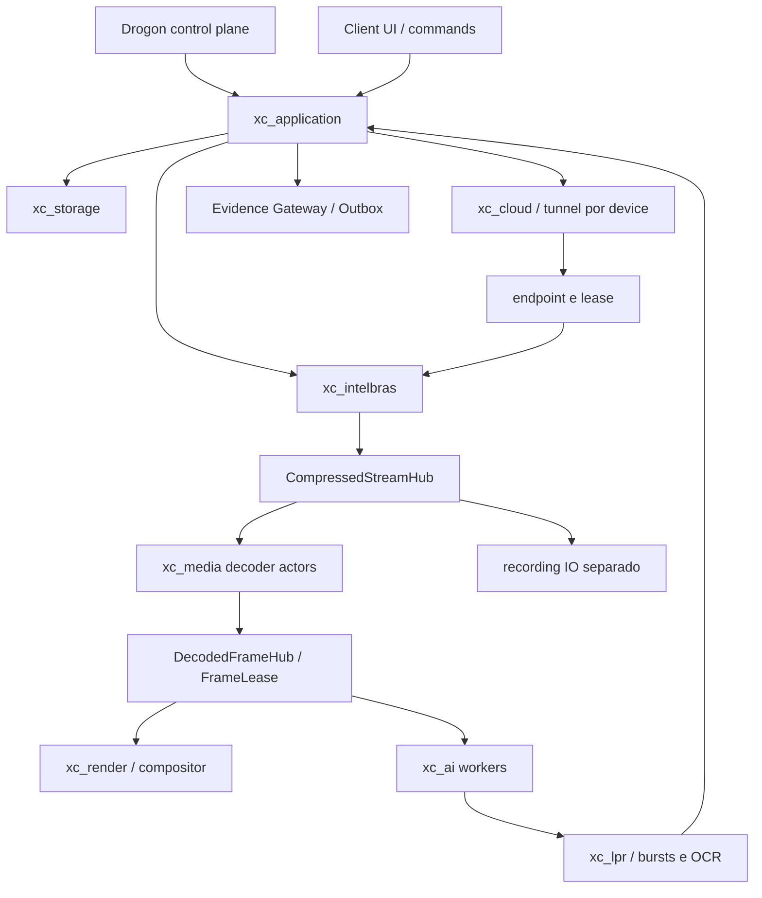

# Arquitetura C++ proposta — estado Proposed

## Fronteiras e tamanho do produto

Propor dez fronteiras de bibliotecas/targets privados após separar xc_cloud; sem microserviços e sem criar esses targets nesta auditoria:

| Target | Responsabilidade / fronteira |
|---|---|
| xc_core | tipos/domínio puro, contratos versionados, relógios, IDs, erros, políticas, telemetry interfaces; sem Qt/Drogon/NetSDK |
| xc_platform_win | DPAPI/CNG, paths/ACL/handles/host metrics; único lugar de detalhes Windows de controle |
| xc_storage | sqlite3 RAII, statements/transações/schema, catálogo/retention/jobs de manutenção isolados |
| xc_cloud | T2uLibrary/T2uRuntime/CloudTunnel/CloudTunnelManager; bootstrap e túnel por dispositivo, independente de NetSDK |
| xc_intelbras | NetSDK nativo, login em endpoint/lease loopback, canais/PTZ/eventos/RealPlay; não conhece implementação T2U |
| xc_media | compressed hub/demux/decode/frame hub/recording/snapshot input; FFmpeg e fallback PlaySDK encapsulados |
| xc_render | D3D11/compositor/present/overlays e adapter do framework escolhido; não detém perfil LPR |
| xc_ai | preprocessing, backend ORT/WinML/etc, detector, tracker e rules domain |
| xc_lpr | detector/OCR/variants/quality/consensus/dedup/gates; sem Python no runtime principal final |
| xc_application | events/actions/evidence/integrations/config orchestration; subdiretórios/namespaces, sem quatro libs artificiais no primeiro dia |

xc_contracts/xc_telemetry ficam inicialmente em xc_core; security de domínio em core e Windows em platform; events/actions/integrations/evidence em application, com separação lógica testável. Só separar target após existir fronteira de dependência, segurança ou tempo de build real. apps/xc-server compõe Drogon/services; apps/xc-client compõe Qt candidato/render/estado. Não espalhar o framework no domínio.



## Threading explícito

Control plane: poucos event loops Drogon (começar com 1–2 por processo, parâmetro de laboratório); parse/validação/auth/dispatch curtos. Nenhum login síncrono, disco pesado, decode, inferência ou OCR nesses loops. Futures/callbacks devolvem completion com deadline e cancelamento.

NetSDK: callbacks são threads do fornecedor; buffer emprestado só dura o callback até documentação provar o contrário. Copiar uma vez para packet pool, enfileirar referência e retornar. Worker de controle serializado onde contrato SDK exigir; não forçar serialization global de toda mídia. Cloud/disconnect/reconnect por geração cancelam fontes antigas. Operação PTZ também atravessa adapter, sem bypass.

Media: actors por fonte com processamento serial local, escalonados em pool limitado; não criar uma std::thread por câmera como padrão. FFmpeg/driver podem ter threads internas por decoder: contar/limitar configurações, não ocultar. Decoder workers separados de IO/recording; fila comprimida com limite por bytes/tempo e política de descontinuidade/keyframe, frame de análise latest de capacidade1 e render mailbox1. Loop de render dedicado ao device/context, sincronizado ao compositor; metadados de UI no thread da UI.

Inferência: scheduler justo por fonte com metadata bounded, pool de contextos por backend/model/device, inflight configurado por medição. No máximo um resultado de detector por frame/config compatível compartilhado; tracker serial por fonte; ROI/gate independente por perfil. LPR bursts bounded por frames/bytes/prazo, OCR pool distinto. SQLite: writer jthread único por store com fila limitada e transações curtas; leitores dedicados/read-only quando possível, sem compartilhar statement mutável entre threads.

RAII/std::jthread/std::stop_token; cancelamento é cooperativo, não encerra à força uma chamada SDK travada. Nessa hipótese planejar processo de isolamento futuro com kill/recovery explícito, sem descarregar DLL ainda em callback. Shutdown: parar admissão → invalidar geração → desinscrever fontes → drenar/cancelar jobs → aguardar GPU fences/tasks → fechar readers/writers/handles → cleanup SDK por último. Ordem verificável por testes. Mutex por source/store/context; evitar lock global de produto e documentar ordem de aquisição para callbacks não esperarem UI.

## Ownership e memória

unique_ptr para proprietários exclusivos (device/source/decoder/session). shared_ptr<const FrameLease/PacketLease> inicialmente para fanout real; intrusive refcount só após profile provar ganho. Ponteiro cru apenas non-owning com prazo declarado. AVPacket/AVFrame/AVBufferRef e handles COM por deleters/ComPtr; FrameLease contém pixel format, planes/strides, dimensão, colorimetria, UTC/PTS/timebase e relógio monotônico, device/stream/generation/sequence e fence de GPU.

Pools têm orçamento global e por fonte (bytes/VRAM/frames), counters/high-water e regra de recusa. Frames em bursts retêm lease até finalizar; não devolver superfície GPU ao decoder antes de render/AI terminarem. Borrowing de const span não prolonga vida. GPU device lost invalida geração e leases; cleanup só depois da sincronização possível. Preprocess compartilha resize por modelo/ROI compatível, não reutiliza resultado quando perfil/transform difere.

Não prometer um único decoder entre Server e Client remoto. Cada processo/remoto tem dispositivo/ownership próprios; usar compressed transport e decode local. Shared GPU handles na mesma máquina exigem flags compatíveis, ACL, sincronização e benchmark; não são ponteiros comuns nem eliminam cópias automaticamente. Co-localização opcional media worker→AI/render pode diminuir cópias, mas Server headless e múltiplos Clients precisam continuar possíveis.

## Control plane e JSON

Drogon1.9.14 é candidato estável observado, MIT, REST/HTTPS/WebSocket/async; suitability depende de Windows, TLS, shutdown e soak, não de benchmark web genérico. SignalR não vem embutido. JsonCpp já é dependência do Drogon: usar no boundary e DTOs tipados no domínio; nlohmann/json só se ergonomia/testes exigirem benefício concreto, simdjson só em profiling de leitura intensiva. Não ter três DOMs ativos sem necessidade. Preservar int64/GUID/null/offset/casing e serializer LAP isolado.

## Harness de compatibilidade — proposta, não implementado

Fixtures sintéticas/versionadas com SHA256: frames/PTS, pacotes/vídeos autorizados, configs sem segredos, eventos, SQLite cópia sanitizada, requests/respostas e datasets de placas autorizados. Três raízes: input read-only, oracle-r25-output isolado e cpp-output isolado. O oracle roda futuramente em cópia controlada, nunca no root operacional e nunca com os dois writers na mesma base. Nesta auditoria nem oracle foi executado.

Comparar decisões discretas exatamente (IDs de regra/estado, crossing direction, consenso, payload keys), imagens/tensores por tolerância definida (CPU referência primeiro; backend GPU não precisa bitwise), eventos em ordem causal/por ID, JSON canônico com exceções documentadas de formatting. Banco: comparar schema, registros e transações/failpoints, não bytes físicos do SQLite. Mudanças intencionais exigem ADR/versionamento, não atualização automática do golden para passar teste.

## Estrutura futura exata da CPP-001

Somente proposta textual; nenhuma destas pastas/implementações foi criada nesta auditoria:

```text
apps/xc-server/          # health e lifecycle, bind loopback
apps/xc-client/          # shell mínimo do candidato UI, sem câmera
libs/xc-core/           # DTO/error/time/RootContext
libs/xc-platform-win/   # paths isolados e log adapter
cmake/                  # toolchain/options
CMakeLists.txt
CMakePresets.json
vcpkg.json
vcpkg-configuration.json
tests/unit/
tests/integration/
tests/compatibility/fixtures/
scripts/windows/        # configure/build/test reproducíveis
docs/adrs/
```

Restantes targets só no milestone que os usa. C++20, VS2022/MSVC v143 x64, CMake/Ninja, baseline vcpkg fixado por commit e features mínimas; Debug/RelWithDebInfo/Release, CRT uniforme (/MD e /MDd conforme configuração). Não misturar import libs/CRT/architecture do SDK. Pin toolchain/SDK/Qt/FFmpeg/ORT com hashes/SBOM; no setup manual oculto. Conferir suporte da versão candidata ao toolset real antes do lock. Nenhuma instalação/toolchain/produto foi feita nesta AUDIT-001.

Referências: [Drogon](https://github.com/drogonframework/drogon), [releases](https://github.com/drogonframework/drogon/releases), [vcpkg manifest](https://learn.microsoft.com/en-us/vcpkg/concepts/manifest-mode). As decisões de desenho acima são propostas da auditoria, não capacidades automaticamente fornecidas pelos frameworks.

## Cloud/T2U — atualização documental

[addendum Intelbras/Cloud](../AUDIT-001-INTELBRAS-CLOUD-ADDENDUM.md) detalha T2uLibrary (LoadLibraryW/GetProcAddress/export validation), T2uRuntime process-wide (init/callbacks/exit), CloudTunnel (status/Direct/Relay/NAT/loss/bandwidth/ports/recovery) e CloudTunnelManager (um por device quando possível, referências/reconnect/telemetry). Túnel vive além de RealPlay; somente o fim da sessão/última referência apropriada autoriza destruição. NetSDK recebe interface endpoint/lease, não implementação T2U. CPP-001 futura pode preservar apenas interfaces/fakes sem SDK operacional, SIM Next ou DLL redistribuída. Bootstrap oficial permanece gate; nunca hardcodear credential.